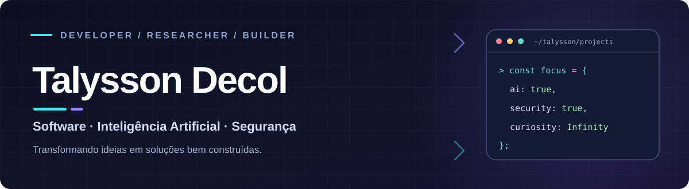

  

**Computer Science Student · Software Engineering · AI & Cybersecurity**

---

### 👋 Sobre mim

Sou **Talysson**, estudante de **Ciência da Computação**, interessado em construir software que una uma boa experiência de uso a fundamentos técnicos sólidos.

Exploro diferentes camadas da tecnologia: de **aplicações web e APIs** a **inteligência artificial, criptografia e sistemas de baixo nível**. Gosto de experimentar, entender como as coisas funcionam e transformar ideias em projetos concretos.

- 🧠 **IA & dados:** aprendizado de máquina, análise de dados e experimentos com algoritmos.
- 🔐 **Segurança:** criptografia, autenticação e estudo de sistemas mais confiáveis.
- 🛠️ **Engenharia:** desenvolvimento full stack, arquitetura de aplicações e otimização.
- 🔬 **Mentalidade:** aprender construindo, testar hipóteses e documentar descobertas.

### 🎓 Formação acadêmica

**Bacharelado em Ciência da Computação** — Universidade Positivo (UP)  
Previsão de conclusão: **dezembro de 2027**

Áreas de interesse: engenharia de software, inteligência artificial, segurança da informação e sistemas.

### ⚙️ Tecnologias e ferramentas

**Linguagens**

**Desenvolvimento e experimentação**

### 🚀 Projetos em destaque

Projetos públicos que representam diferentes áreas do meu aprendizado e desenvolvimento:

| Projeto | O que estou explorando | Tecnologias / área |
|:--|:--|:--|
| **[Astral — Unsupervised Clustering](https://github.com/TalyssonDLF/astral_unsupervised_clustering)** | Análise experimental de sequências de proteínas com descritores esparsos, SVD, 6 métodos de clusterização, métricas e gráficos. | Python · scikit-learn |
| **[VaultGuard](https://github.com/TalyssonDLF/VaultGuard)** | Backend experimental de cadastro e login com Argon2, JWT, Prisma e PostgreSQL. Inclui documentação dos cuidados de segurança pendentes. | NestJS · TypeScript · PostgreSQL |
| **[AES em C](https://github.com/TalyssonDLF/AES-em-C)** | Implementação educacional do AES-256-CBC com operações de cifra, decifra e documentação das limitações de segurança. | C · Criptografia |
| **[Capivarinha 2.0](https://github.com/TalyssonDLF/Capivarinha-2.0)** | Estrutura inicial full stack com frontend e backend separados; evolução funcional ainda em andamento. | React · TypeScript · NestJS |

> **Transparência técnica:** os projetos têm diferentes níveis de maturidade. Cada repositório agora contém documentação sobre o que está implementado, como explorar o código e o que ainda precisa evoluir.

### 🎯 O que me motiva

Acredito que aprender tecnologia vai além de conhecer frameworks. É saber **investigar problemas, tomar decisões conscientes e criar soluções que funcionem no mundo real**.

Me interesso especialmente pela interseção entre **IA, segurança da informação e engenharia de software** — e por desafios que exigem aprender algo novo.

---

**Tem uma ideia, uma dúvida técnica ou quer trocar experiências?**

[**✉️ Vamos conversar**](mailto:talyssonlago@gmail.com) · [**💻 Veja meus projetos**](https://github.com/TalyssonDLF?tab=repositories)

Feito com curiosidade, código e vontade de continuar aprendendo.

